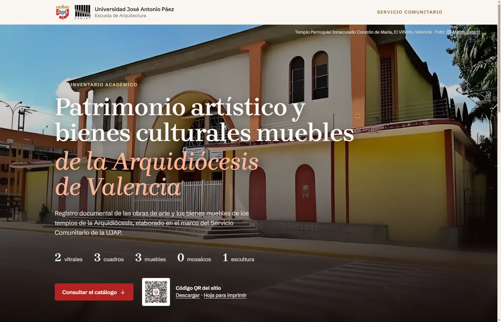
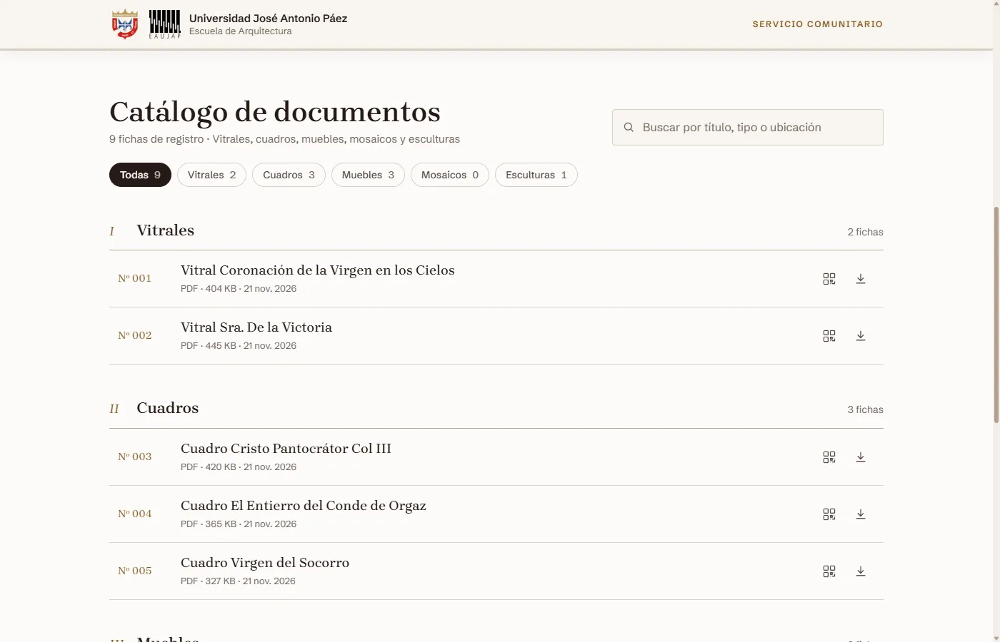

# Inventario de Patrimonio Artístico

<p align="center">
  
</p>

<p align="center">
  <strong>Academic inventory of artistic heritage and movable cultural property of the Archdiocese of Valencia, Venezuela.</strong><br />
  A community-service project of the Universidad José Antonio Páez · Escuela de Arquitectura.
</p>

<p align="center">
  <a href="https://patrimonio-arquidiocesis-valencia.arq-hillary-ruiz.workers.dev"></a>
  
  
  
  
  
  
</p>

<p align="center">
  
  
</p>

---

## About

Architecture students document every artwork and movable object in the Archdiocese's churches on a standard **record sheet** (*ficha de registro*). This project turns those sheets into a public, searchable catalog with **no technical work for the students**: they drop the PDF in a shared Google Drive folder, and a few minutes later it is online, with its own **QR code printed inside the sheet**, ready to be stuck on the physical piece.

## Key Features

- **Drive → website, automatically.** An Apps Script watcher detects uploads, replacements and deletions in Drive and triggers a GitHub Actions build that publishes to Cloudflare in ~2 minutes.
- **QR stamped into each PDF.** The build finds the sheet's *CÓDIGO QR* cell (or the blank cell under *CÓDIGO DE FICHA*), enlarges it to ~3 cm by editing the PDF content stream, and draws the QR with the UJAP shield in the centre. Text stays real and selectable, with no duplication.
- **One tidy page per sheet.** Sheets that the spreadsheet split across pages are joined back into one taller page, and margins are trimmed to the content.
- **Stable QR codes.** Each QR encodes `?d=<slug>` derived from the file name, so replacing a PDF with the same name keeps every printed code working.
- **In-page PDF viewer.** PDF.js renders pages lazily, with an invisible text layer for selection and search, zoom controls, deep links and history support.
- **Pre-rendered catalog.** The list, counters and filters are written into the HTML at build time by the same view module the browser uses for search and filtering.
- **Fixed categories.** Vitrales, Cuadros, Muebles, Mosaicos, Esculturas (folder names are matched case- and accent-insensitively); sub-folders become the *location*.
- **Images optimized to WebP**, an edge-flood-fill transparent favicon, a vectorized EAUJAP logo for the animated splash that morphs into the header, and a design built around the archival "museum register" idea.
- **Safety nets.** The sync refuses to publish an empty or inaccessible folder; deploys never overlap; a scheduled run catches anything the watcher misses.

---

## How It Works

```
Google Drive  FICHAS/                     GitHub Actions                         Cloudflare Workers
  VITRALES/  CUADROS/  MUEBLES/    ──▶   1. sync-drive.mjs   (service account)  ──▶  static assets
  MOSAICOS/  ESCULTURAS/                 2. build.mjs        (QR, stamp, fit,        patrimonio-arquidiocesis-valencia
        │                                                     WebP, pre-render)      .arq-hillary-ruiz.workers.dev
        └── Apps Script watcher ──────▶  3. wrangler deploy
            (every 5 min, repository_dispatch)
```

## Tech Stack

| Layer          | Tool                                         | Notes                                   |
| -------------- | -------------------------------------------- | --------------------------------------- |
| Hosting        | Cloudflare Workers (static assets)           | Free plan                               |
| Build          | Node.js 24, plain ES modules                 | No framework                            |
| PDF editing    | pdf-lib + pdfjs-dist                         | Content-stream surgery, page fitting    |
| QR             | qrcode + sharp                               | Error correction H, logo in the centre  |
| Images         | sharp (WebP), potrace (SVG tracing)          | Local AI upscaling via ComfyUI          |
| Viewer         | PDF.js 3.11 (CDN)                            | Canvas + text layer                     |
| Content source | Google Drive + service account (read-only)   | Signed JWT, no Google SDK               |
| Automation     | GitHub Actions + Google Apps Script          | `repository_dispatch`, cron fallback    |

---

## Getting Started

### Prerequisites

- Node.js 24+
- A Cloudflare account (for `wrangler deploy`)
- Optional: a Google service account with read access to the Drive folder

### Install & build

```bash
git clone https://github.com/ManguitoDeveloper/valencia-archdiocese-heritage-inventory.git
cd valencia-archdiocese-heritage-inventory
npm install
npm run build        # builds ./dist from ./documentos (put PDFs in documentos/<Category>/)
npm run preview      # serve locally
```

### Production setup

| Name                          | Type     | Purpose                                          |
| ----------------------------- | -------- | ------------------------------------------------ |
| `CLOUDFLARE_API_TOKEN`        | secret   | "Edit Cloudflare Workers" token                  |
| `GOOGLE_SERVICE_ACCOUNT_JSON` | secret   | Service-account key (Drive read-only)            |
| `DRIVE_FOLDER_ID`             | secret   | Root folder of the sheets                        |
| `SITE_URL`                    | variable | Public address encoded in every QR code          |

Then install [`scripts/drive-watcher.gs`](scripts/drive-watcher.gs) in Google Apps Script (instructions inside the file) for instant publishing.

---

## Project Structure

```
inventario-patrimonio/
├── build.mjs                 # Build: sync output → QR → stamp → fit pages → WebP → pre-render
├── lib/
│   ├── stamp-qr.mjs          # Finds the QR cell, enlarges it, draws the QR (no text duplication)
│   ├── fit-pages.mjs         # One page per sheet: crops to content, joins split pages
│   └── catalog-view.cjs      # Catalog markup, shared by the build and the browser
├── scripts/
│   ├── sync-drive.mjs        # Mirrors the Drive folder into ./documentos
│   ├── drive-watcher.gs      # Apps Script: detects Drive changes, triggers the workflow
│   └── enhance.mjs           # Local photo upscaling through ComfyUI (Real-ESRGAN)
├── public/                   # index.html (site + viewer), qr.html (printable QR sheet)
├── assets-src/               # Source photos and logos (converted to WebP at build time)
├── docs/                     # README images
├── .github/workflows/        # deploy.yml
└── wrangler.jsonc            # Cloudflare Workers config
```

---

## Scripts

| Script                 | Description                                                    |
| ---------------------- | -------------------------------------------------------------- |
| `npm run build`        | Build `./dist` from `./documentos`                             |
| `npm run preview`      | Serve the build locally                                        |
| `npm run sync`         | Mirror the Drive folder into `./documentos` (needs credentials)|
| `npm run publish`      | Trigger the GitHub publish workflow                            |
| `npm run deploy:local` | Build and deploy from the local folder (bypasses Drive)        |
| `npm run enhance`      | Upscale a photo with local AI (ComfyUI + Real-ESRGAN)          |

---

## Credits

- Record sheets: students of the UJAP Escuela de Arquitectura, Servicio Comunitario.
- Banner photo: Templo Parroquial Inmaculado Corazón de María, by [Martín Ustáriz](https://www.instagram.com/p/DD42s0TPUU5/).
- Logos: Universidad José Antonio Páez and its Escuela de Arquitectura.

## License

The code is released under the [MIT License](LICENSE).

The license covers the code only. These are **not** included and remain with their owners:

- The record sheets (PDF fichas) and their content: their authors and the Arquidiócesis de Valencia.
- The UJAP and Escuela de Arquitectura logos (`assets-src/ujap-logo.png`, `assets-src/arquitectura*.png`).
- The banner photo (`assets-src/iglesia.png`) by Martín Ustáriz.

---

<p align="center">
  Built by <strong>Daniel Hernández</strong> (Manguito Developer) ·
  <a href="https://github.com/ManguitoDeveloper">GitHub</a> ·
  <a href="https://www.linkedin.com/in/manguito-dev/">LinkedIn</a>
</p>
